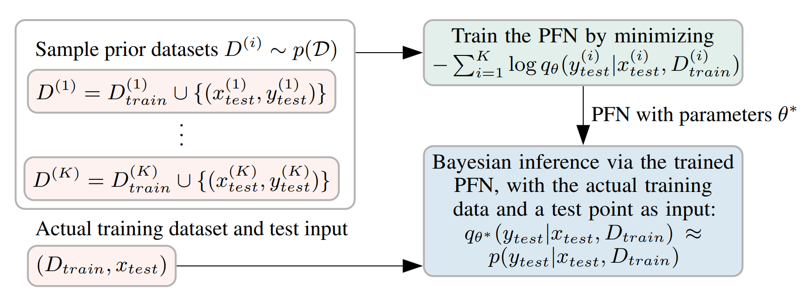
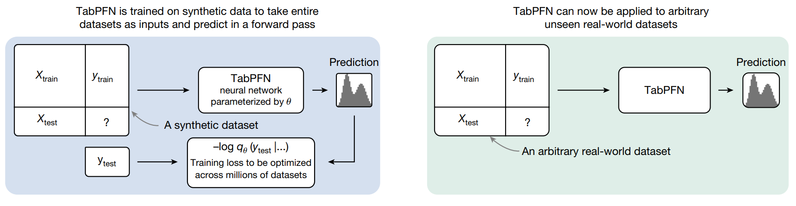

# Prior-data Fitted Networks (PFN) Tutorial ⚡🧠

[](https://colab.research.google.com/github/barhanc/pfn-tutorial/blob/main/pfn-tutorial.ipynb)
[](https://github.com/astral-sh/uv)
[](https://www.python.org/)
[](https://pytorch.org/)
[](https://jupyter.org/)
[](LICENSE)

An intuitive, hands-on tutorial and PyTorch implementation of **Prior-data Fitted Networks (PFNs)** — the breakthrough meta-learning framework powering foundational tabular models like **TabPFN**.

---

## 💡 What are Prior-data Fitted Networks?

Traditional machine learning algorithms optimize parameters $\theta$ by performing gradient descent directly on a training dataset $D = \{(\mathbf{x}_i, y_i)\}_{i=1}^n$. 

**Prior-data Fitted Networks (PFNs)** fundamentally reframe supervised learning:
Instead of training on a specific dataset at inference time, a Transformer is pre-trained on millions of synthetic datasets sampled from a broad prior distribution $p(D)$. In a single forward pass, the model performs **in-context Bayesian posterior approximation**:

$$q_\theta(y \mid \mathbf{x}, D) \approx p(y \mid \mathbf{x}, D)$$

At test time, the network makes predictions on unseen datasets in fractions of a second with **zero gradient steps**, hyperparameter tuning, or cross-validation.

<p align="center">
  
</p>

---

## 📑 Overview

| Notebook | Description | Target Audience |
| :--- | :--- | :--- |
| [**`pfn-tutorial.ipynb`**](./pfn-tutorial.ipynb) | Complete tutorial with theoretical background, full PyTorch implementation, training loop, and evaluation. | Self-study, reference, and experimentation. |
| [**`pfn-tutorial-empty.ipynb`**](./pfn-tutorial-empty.ipynb) | Exercise version containing empty implementation blocks (`Zadanie 1–3`) and guided instructions. | Classroom labs and hands-on workshops. |

---

## 🔬 Hands-On Curriculum

### 1. Transformer Architecture for Tabular Data
- Constructing an **Encoder-Decoder Transformer** tailored for dataset handling:
  - **Encoder**: Encodes the labeled support set $D_{\text{train}} = \{(\mathbf{x}_i, y_i)\}_{i=1}^n$ into permutation-invariant dataset representations using joint input-target linear projections.
  - **Decoder**: Receives query features $\mathbf{x}_{\text{test}}$ and attends to the encoded support set via cross-attention to output predictive distributions.

### 2. Prior-Data Generation & Meta-Training
- Sampling synthetic classification tasks on-the-fly using mixture Gaussian and non-linear classification priors (`scikit-learn` dataset generators).
- Meta-training the Transformer end-to-end using negative log-likelihood (cross-entropy) over the query batch:

$$\mathcal{L}(\theta) = - \mathbb{E}_{D \sim p(D)} \left[ \sum_{(\mathbf{x}, y) \in D_{\text{test}}} \log q_\theta(y \mid \mathbf{x}, D_{\text{train}}) \right]$$

### 3. In-Context Evaluation & Benchmarking
- Evaluating the trained PFN on novel tasks sampled from the prior.
- Direct performance and speed comparison against traditional supervised neural networks trained per-dataset from scratch with Adam/SGD.

<p align="center">
  
</p>

---

## 🚀 Getting Started

Ensure you have [uv](https://docs.astral.sh/uv/) installed.

### 1. Clone & Sync Environment

```bash
git clone https://github.com/barhanc/pfn-tutorial.git
cd pfn-tutorial

# Synchronize the virtual environment with uv.lock in seconds
uv sync
```

### 2. Launch the Tutorial

Run JupyterLab or Jupyter Notebook directly via `uv`:

```bash
uv run jupyter lab
# or
uv run jupyter notebook
```

Alternatively, open the notebook in one click using [Google Colab](https://colab.research.google.com/github/barhanc/pfn-tutorial/blob/main/pfn-tutorial.ipynb).

---

## 📚 Key References

- **Prior-data Fitted Networks**: Müller et al., *"Transformers Can Do Bayesian Inference"*, ICLR 2022. [[arXiv:2112.10510](https://arxiv.org/abs/2112.10510)]
- **TabPFN**: Hollmann et al., *"TabPFN: A Transformer That Solves Small Tabular Classification Problems in a Second"*, Nature 2025 / ICLR 2023. [[arXiv:2207.01848](https://arxiv.org/abs/2207.01848)]
